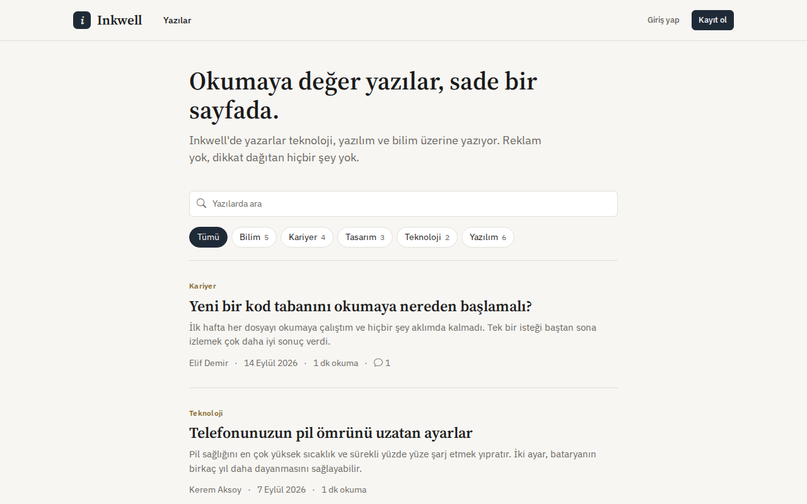
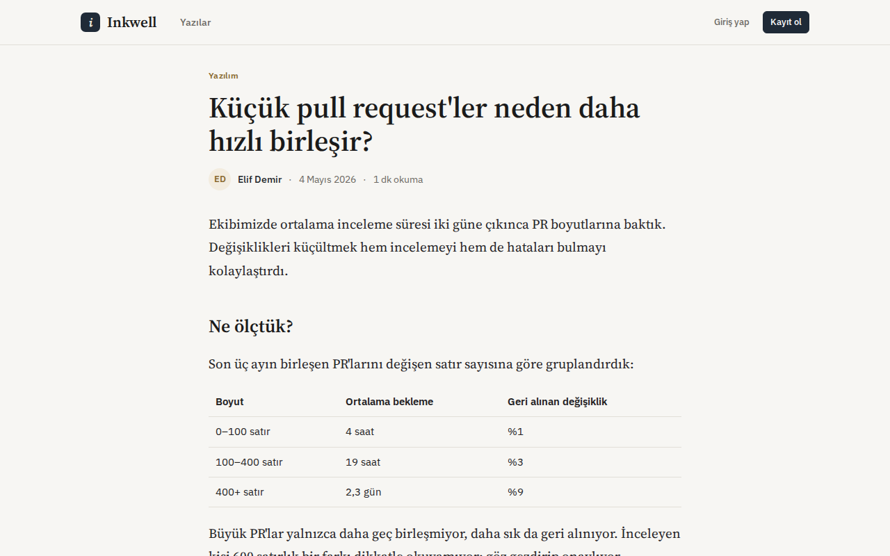
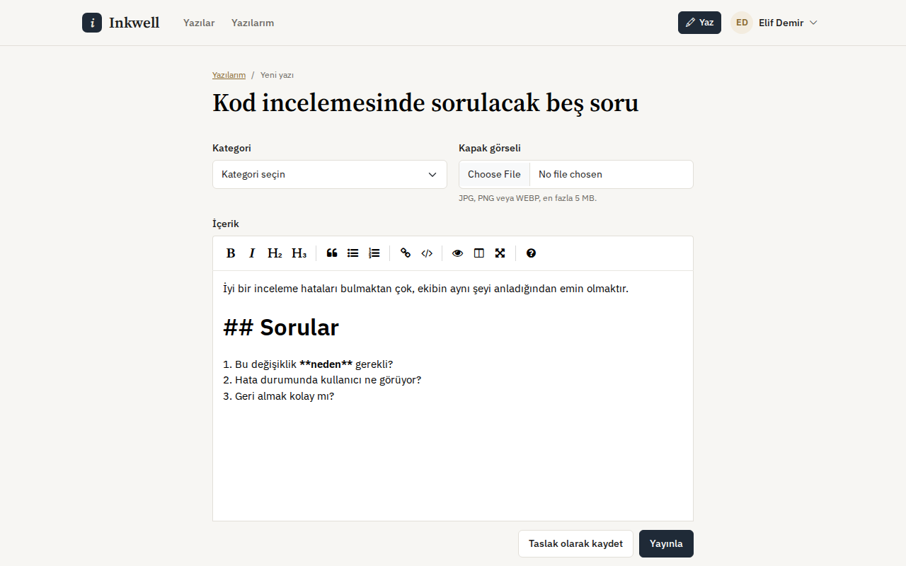
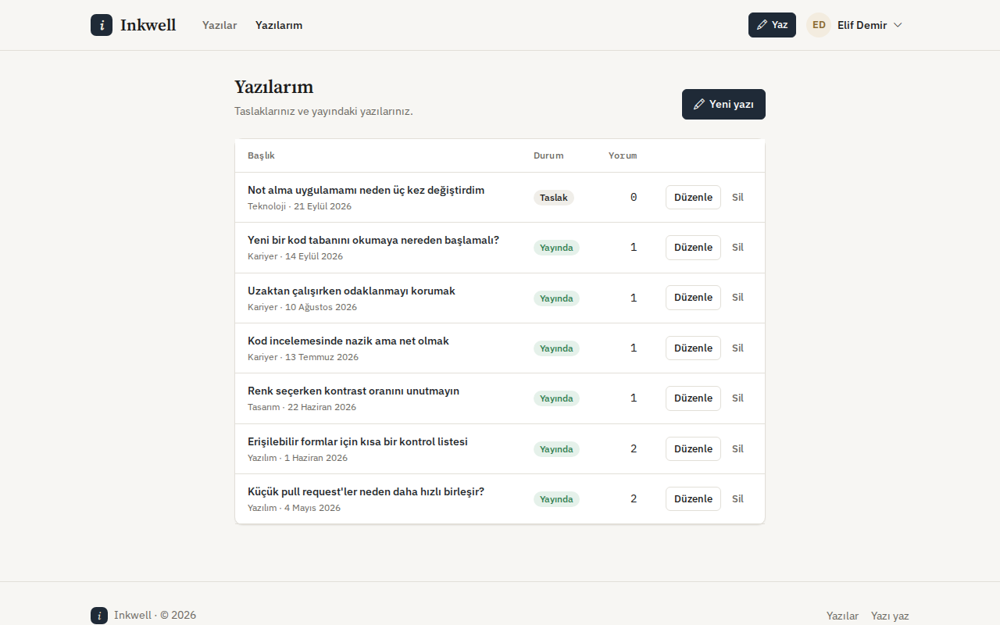
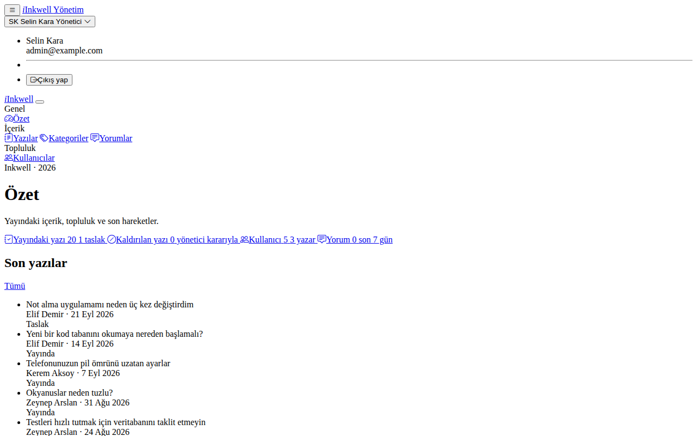
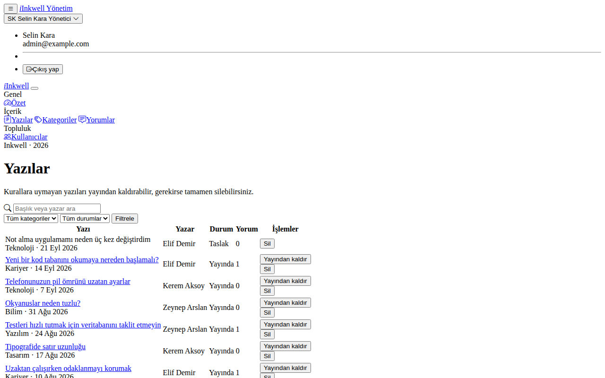
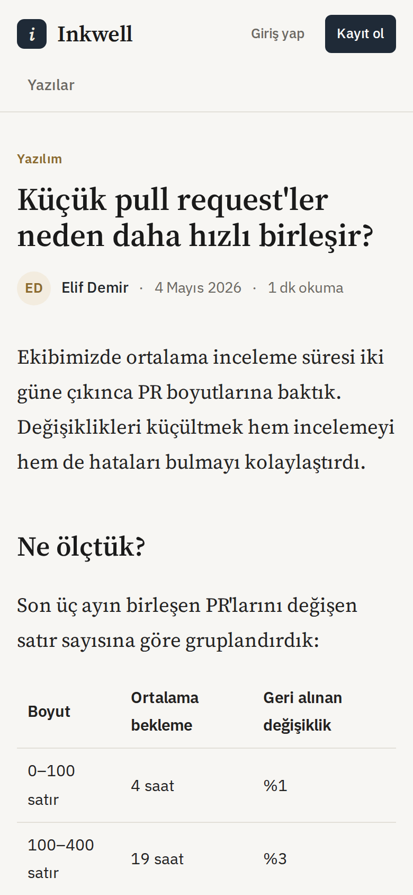
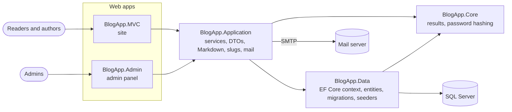

# Inkwell

**English** · [Türkçe](README.tr.md)

A multi-author blog: write in Markdown, keep drafts, publish with a readable URL, and moderate everything from a separate admin panel.

[](https://github.com/Beratoguzhan620/inkwell/actions/workflows/ci.yml)


## Demo accounts

Start the site with demo content (see [Running locally](#running-locally)) and sign in with:

| Role | E-mail | Password | Where |
|---|---|---|---|
| Author | `elif@example.com` | `Demo123!` | site |
| Reader | `okur@example.com` | `Demo123!` | site |
| Admin | `admin@example.com` | `Demo123!` | admin panel |

The demo content has three authors, twenty published posts in five categories, a draft and reader comments.

## Features

- **Writing:** Markdown editor with preview, drafts, cover images, publish and unpublish. Each post gets a Turkish-friendly slug (`/posts/calisan-yazilim-ekipleri`) that stays stable after publishing.
- **Reading:** paged home page with category filter and search, reading time, code blocks, tables and quotes, comments.
- **Accounts:** registration with e-mail verification (6-digit code or link), resend with a cooldown, password reset with one-time links that expire after an hour.
- **Roles:**
  - Authors write.
  - Readers read and comment.
  - Admins manage the site from a separate app with its own sign-in.
- **Admin panel:**
  - Dashboard.
  - Posts: search, filter, take down or delete.
  - Users: change roles, disable accounts.
  - Comments: bulk delete.
  - Categories: create, rename, delete.
- **UI:** server-rendered, works down to 360 px, Turkish interface, serif headings for long-form reading.

## Screenshots

| Home | Post |
|---|---|
|  |  |
| **Editor** | **My posts** |
|  |  |
| **Admin dashboard** | **Admin: posts** |
|  |  |

<p align="center"></p>

## Tech stack

- ASP.NET Core MVC on .NET 10 (two apps: the site and the admin panel)
- Entity Framework Core 10 with SQL Server, code-first migrations
- Markdig for Markdown, EasyMDE as the editor
- Bootstrap 5 with a small custom design system ([docs/DESIGN.md](docs/DESIGN.md))
- xUnit with in-memory SQLite for service tests, Playwright for UI screenshots
- GitHub Actions: build, tests, a pending-migration check and a UI preview on every pull request

## Architecture



The services work on the EF Core context directly instead of a generic repository; the reasoning is in [docs/decisions/0001-no-generic-repository.md](docs/decisions/0001-no-generic-repository.md). Both apps share the database; the admin panel uses its own cookie, so being signed in on the site does not open the panel.

## Running locally

Requirements: .NET 10 SDK and SQL Server (LocalDB works).

```bash
git clone https://github.com/Beratoguzhan620/inkwell.git
cd inkwell

# Development settings (connection string, demo content); edit if you are not using LocalDB
cp BlogApp.MVC/appsettings.Development.example.json BlogApp.MVC/appsettings.Development.json
cp BlogApp.Admin/appsettings.Development.example.json BlogApp.Admin/appsettings.Development.json

# Site: https://localhost:7009 (applies migrations and seeds on start)
dotnet run --project BlogApp.MVC --launch-profile https

# Admin panel, in a second terminal: https://localhost:7020
dotnet run --project BlogApp.Admin --launch-profile https
```

Without SMTP settings no e-mail is sent; in Development the verification code and the reset link are shown on the page instead. For a real server, set `ConnectionStrings__DefaultConnection`, `Admin__Email`, `Admin__Password`, `AppUrl` and `EmailSettings__*` as environment variables.

## Tests

```bash
dotnet test
```

The tests run `AuthService` and `BlogPostService` against an in-memory SQLite database, so real SQL, unique indexes and `ExecuteUpdate` are exercised. They cover:

- **Accounts:** registration, verification, code expiry, the resend cooldown, sign-in rules, and reset links that work once, expire and cancel older links.
- **Posts:** slugs, draft visibility, author-only editing, stable URLs after publishing, admin take-downs, and paging and filtering.

The UI preview workflow ([.github/workflows/ui-preview.yml](.github/workflows/ui-preview.yml)) starts both apps against a throwaway SQL Server, walks through the main flows with Playwright at desktop and 360 px widths, and fails if a page scrolls sideways.

## Roadmap and known gaps

- Tags in addition to categories.
- An RSS feed.
- Docker Compose setup.

The full history of the rebuild is in [docs/ROADMAP.md](docs/ROADMAP.md).

## Background

This project started as a bootcamp project and was later rebuilt from the ground up. What changed:

- **Design:** a reading-focused interface on a small design system, usable on phones; a separate, simple admin panel.
- **Features:** Markdown editor with drafts, slugs, cover images, search, roles, e-mail verification, password reset, moderation.
- **Code:** clearer service layer, authorization checks on every write, migrations applied on start-up, secrets out of the repository.
- **Tests and CI:** service tests on SQLite, a pending-migration check and automated UI screenshots on every pull request.

## License

[MIT](LICENSE) · Berat Oğuzhan Turğut · [GitHub](https://github.com/Beratoguzhan620)
