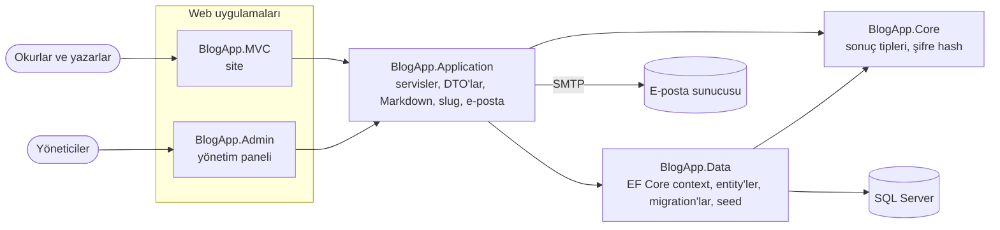

# Inkwell

[English](README.md) · **Türkçe**

Çok yazarlı blog: Markdown ile yazın, taslak tutun, okunaklı bir adresle yayınlayın ve her şeyi ayrı bir yönetim panelinden denetleyin.

[](https://github.com/Beratoguzhan620/inkwell/actions/workflows/ci.yml)


## Demo hesapları

Siteyi demo içerikle başlatın ([Yerelde çalıştırma](#yerelde-çalıştırma)) ve şu hesaplarla giriş yapın:

| Rol | E-posta | Şifre | Nerede |
|---|---|---|---|
| Yazar | `elif@example.com` | `Demo123!` | site |
| Okur | `okur@example.com` | `Demo123!` | site |
| Yönetici | `admin@example.com` | `Demo123!` | yönetim paneli |

Demo içerikte üç yazar, beş kategoride yirmi yayında yazı, bir taslak ve okur yorumları var.

## Özellikler

- **Yazma:** önizlemeli Markdown editörü, taslaklar, kapak görseli, yayınlama ve yayından kaldırma. Her yazı Türkçe karakterleri dönüştüren okunaklı bir adres alır (`/posts/calisan-yazilim-ekipleri`); yayından sonra adres değişmez.
- **Okuma:** kategori filtresi ve aramalı, sayfalı ana sayfa; okuma süresi, kod blokları, tablolar, alıntılar ve yorumlar.
- **Hesaplar:** e-posta doğrulamalı kayıt (6 haneli kod veya bağlantı), bekleme süreli yeniden gönderme, bir saat geçerli ve tek kullanımlık şifre sıfırlama bağlantıları.
- **Roller:**
  - Yazar yazar.
  - Okur okur ve yorum yapar.
  - Yönetici siteyi kendi girişi olan ayrı bir uygulamadan yönetir.
- **Yönetim paneli:**
  - Özet ekranı.
  - Yazılar: arama, filtre, yayından kaldırma veya silme.
  - Kullanıcılar: rol değiştirme, hesap kapatma.
  - Yorumlar: toplu silme.
  - Kategoriler: ekleme, yeniden adlandırma, silme.
- **Arayüz:** sunucu tarafında üretilen sayfalar, 360 px genişliğe kadar sorunsuz, Türkçe arayüz, uzun okumalar için serif başlıklar.

## Ekran görüntüleri

| Ana sayfa | Yazı |
|---|---|
|  |  |
| **Editör** | **Yazılarım** |
|  |  |
| **Yönetim: özet** | **Yönetim: yazılar** |
|  |  |

<p align="center"></p>

## Teknolojiler

- .NET 10 üzerinde ASP.NET Core MVC (iki uygulama: site ve yönetim paneli)
- Entity Framework Core 10 + SQL Server, code-first migration'lar
- Markdown için Markdig, editör olarak EasyMDE
- Küçük bir tasarım sistemiyle Bootstrap 5 ([docs/DESIGN.md](docs/DESIGN.md))
- Servis testleri için xUnit + bellek içi SQLite, arayüz görüntüleri için Playwright
- GitHub Actions: her pull request'te build, testler, eksik migration kontrolü ve arayüz önizlemesi

## Mimari



Servisler genel bir repository yerine doğrudan EF Core context'i kullanıyor; gerekçesi [docs/decisions/0001-no-generic-repository.md](docs/decisions/0001-no-generic-repository.md) dosyasında. İki uygulama aynı veritabanını paylaşır; yönetim paneli ayrı bir çerez kullanır, sitede oturum açmak paneli açmaz.

## Yerelde çalıştırma

Gerekenler: .NET 10 SDK ve SQL Server (LocalDB yeterli).

```bash
git clone https://github.com/Beratoguzhan620/inkwell.git
cd inkwell

# Development ayarları (bağlantı cümlesi, demo içerik); LocalDB kullanmıyorsanız düzenleyin
cp BlogApp.MVC/appsettings.Development.example.json BlogApp.MVC/appsettings.Development.json
cp BlogApp.Admin/appsettings.Development.example.json BlogApp.Admin/appsettings.Development.json

# Site: https://localhost:7009 (açılışta migration ve seed uygulanır)
dotnet run --project BlogApp.MVC --launch-profile https

# Yönetim paneli, ikinci terminalde: https://localhost:7020
dotnet run --project BlogApp.Admin --launch-profile https
```

SMTP ayarı yoksa e-posta gönderilmez; Development ortamında doğrulama kodu ve sıfırlama bağlantısı sayfada gösterilir. Gerçek bir sunucuda `ConnectionStrings__DefaultConnection`, `Admin__Email`, `Admin__Password`, `AppUrl` ve `EmailSettings__*` ortam değişkeni olarak verilir.

## Testler

```bash
dotnet test
```

Testler `AuthService` ve `BlogPostService`'i bellek içi SQLite veritabanında çalıştırır; böylece gerçek SQL, benzersiz index'ler ve `ExecuteUpdate` de denenmiş olur. Kapsadıkları:

- **Hesaplar:** kayıt, doğrulama, kodun süresinin dolması, yeniden gönderme beklemesi, giriş kuralları; bir kez çalışan, süresi dolan ve eskisini geçersiz kılan sıfırlama bağlantıları.
- **Yazılar:** slug'lar, taslak görünürlüğü, yalnızca yazarın düzenleyebilmesi, yayından sonra sabit kalan adres, yöneticinin kaldırdığı yazılar, sayfalama ve filtreler.

UI preview iş akışı ([.github/workflows/ui-preview.yml](.github/workflows/ui-preview.yml)) iki uygulamayı geçici bir SQL Server ile başlatır, ana akışları Playwright ile masaüstü ve 360 px genişlikte dolaşır ve yatay kaydırma olan sayfada hata verir.

## Yol haritası ve bilinen eksikler

- Kategorilere ek olarak etiketler.
- RSS beslemesi.
- Docker Compose kurulumu.

Yeniden yapımın tüm aşamaları: [docs/ROADMAP.md](docs/ROADMAP.md).

## Proje geçmişi

Bu proje bir bootcamp projesi olarak başladı, sonra baştan geliştirildi. Neler değişti:

- **Tasarım:** küçük bir tasarım sistemine dayanan, okumaya odaklı ve telefonda rahat kullanılan arayüz; ayrı ve sade bir yönetim paneli.
- **Özellikler:** taslaklı Markdown editörü, slug'lar, kapak görselleri, arama, roller, e-posta doğrulama, şifre sıfırlama, içerik denetimi.
- **Kod:** daha net servis katmanı, her yazma işleminde yetki kontrolü, açılışta uygulanan migration'lar, repodan çıkarılan gizli bilgiler.
- **Test ve CI:** SQLite üzerinde servis testleri, eksik migration kontrolü ve her pull request'te otomatik arayüz görüntüleri.

## Lisans

[MIT](LICENSE) · Berat Oğuzhan Turğut · [GitHub](https://github.com/Beratoguzhan620)
